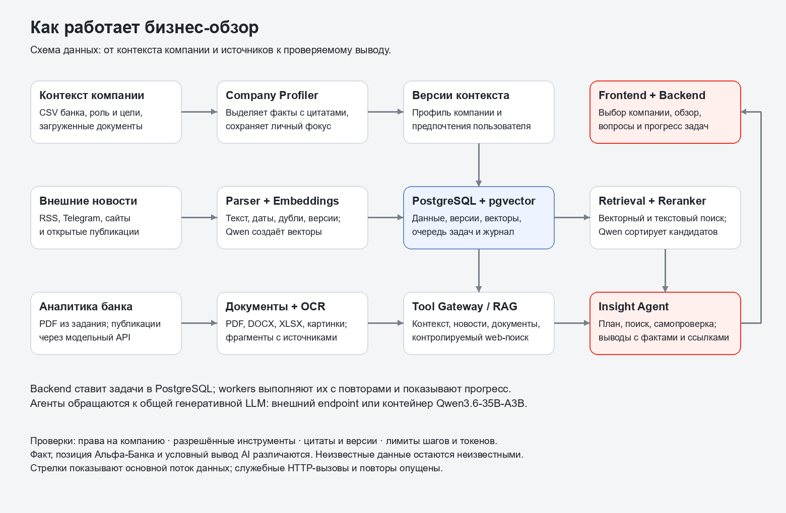

# Как работает система

[Редактируемая схема Draw.io](architecture.drawio). Стрелки показывают основной поток данных, а не каждый HTTP-вызов. PNG имеет размер 1560 × 1020.

## От выбора компании до обзора

1. **Frontend и backend.** В оболочке Альфа-Бизнеса пользователь выбирает компанию, указывает роль, задачи, цели и KPI. Можно загрузить PDF, DOCX, XLSX или изображение. Backend проверяет доступ к компании и ставит длительную работу в очередь PostgreSQL. Workers обрабатывают задачи, повторяют временные сбои и сохраняют состояние для интерфейса.
2. **Профиль.** `company-user-profiler` читает банковские данные и документы через инструменты, извлекает подтверждённые факты и создаёт версию профиля. Личные цели хранятся отдельно от общих фактов компании. Синтетический ID не связывается с реальной организацией по догадке.
3. **Источники.** `parser` собирает новости, сохраняет текст, дату, ревизии и точные дубли. `embedding-service` преобразует текст в векторы. `bank-materials-source` имитирует API публикации банковских материалов из задания; обработчик документов извлекает текст и при необходимости использует OCR.
4. **Отбор.** `retrieval-ranking` берёт зафиксированный контекст, объединяет кандидатов из векторного поиска и русского полнотекстового поиска PostgreSQL. Qwen3-Reranker-0.6B оценивает пары «контекст — новость». Результаты и использованные версии сохраняются в БД.
5. **Интерпретация.** `insight-agent` получает отобранные новости, факты и материалы банка. Он планирует действия, обращается к разрешённым инструментам `tool-gateway`, проверяет результат и исправляет его в пределах бюджета. Для выводов проверяются ссылки на реально полученные источники, цитаты и факты выбранной компании. Утверждение о последствиях должно иметь первичную новость и поддержку независимого издателя; недостаточно обоснованные карточки исключаются.
6. **Результат.** Пользователь видит событие, его значение для своей компании, ограничения и следующий возможный шаг. Подтверждённый факт, позиция банка и условный вывод AI помечаются отдельно. Источники раскрываются в карточке. Вопрос относится к выбранной версии обзора и карточке; ответы сохраняются в истории.

## Где находится код

| Каталог | Ответственность |
|---|---|
| `frontend/`, `backend/` | Интерфейс, API, документы, отчёты, очередь и прогресс |
| `company-user-profiler/` | Версии корпоративного и личного контекста |
| `parser/`, `embedding-service/` | Сбор новостей и их векторизация |
| `retrieval-ranking/` | Поиск кандидатов, ранжирование, сохранение результатов |
| `insight-agent/`, `tool-gateway/` | Подготовка выводов, уточнения, доступ к источникам |
| `bank-materials-source/` | Модельный источник банковских PDF |
| `service-common/` | Контракты, агентный цикл, проверки источников и лимиты |
| `database/`, `infrastructure/` | Схема БД, импорт данных, контейнеры и проверки |

## Как читаются данные задания

Семантика полей уточнена в Q&A организаторов:

- Выручка — за **2025 год, в рублях**. Значение `1000` означает техническую заглушку и не подтверждает реальную выручку. Сегмент крупного бизнеса определяется по группе: отдельное юридическое лицо может иметь меньшую выручку.
- `CITY_NAME` / `RC_NAME` — город и регион обслуживания юридического лица. Регистрация и обслуживание не доказывают расположение производства, покупателей или маршрутов. ФТС указывает страны, но не товары, направление торговли или логистику.
- `PAY_AMT` — сумма в рублях, `PAY_CNT` — число платежей с 1 января; год этого периода не уточнён. Платёжная связь сама по себе не устанавливает отношения «поставщик — покупатель» или зависимость бизнеса.
- Кредитный и лизинговый признаки показывают наличие продукта, но не ставку, срок и условия. Общая группа может объяснять значимость новости только при явно указанном основании.
- Для неизвестного UID банковского профиля нет. Публичные сведения дополняют известный контекст, а не служат единственным критическим основанием; синтетический UID не раскрывает реальную компанию.

Предоставленных банковских материалов достаточно для прототипа. Материал банка привязывается к выводу, когда он помогает его обосновать; его отсутствие у отдельной карточки явно допустимо. Демонстрация использует ограниченный набор компаний, а профиль, очередь и обработка данных не привязаны к их названиям.

## Модели и воспроизводимость

Embedding и reranker — отдельные сервисы Qwen3-0.6B с закреплёнными ревизиями. Они не генерируют аналитический ответ. Генеративный Qwen3.6-35B-A3B подключается по OpenAI-совместимому API: через внешний endpoint или отдельный контейнер в режиме `--with-qwen`. Подробности запуска и параметры модели указаны в [README](README.md).

Агентный цикл реализован в проекте, без готового мультиагентного фреймворка. Модель выбирается из списка задания. Есть ограничения на число шагов, вызовов инструментов, токены, контекст и время выполнения; денежный дневной лимит общего ключа контролируется провайдером.

У недельного обзора фиксированный интервал в семь суток. Поздние новости или обновлённый контекст дают новую версию, а не заменяют старую. Ссылки сохраняют использованные ревизии источников. Если данных или времени недостаточно, интерфейс показывает неполноту результата.

## Доступ и наблюдаемость

- API проверяет пользователя и его членство в компании; инструменты получают ограниченный контекст доступа. Внутренние сервисы используют отдельный токен и не публикуются на портах хоста.
- Загруженные документы и тексты новостей считаются данными, а не инструкциями. Web-поиск ограничен общими разрешёнными темами; произвольные адреса и внутренние сети недоступны через инструмент загрузки страниц.
- В БД сохраняются этапы агента, вызовы инструментов, ошибки, версии профиля и отчёта. `/dev` в демо показывает обезличенное состояние без пароля. Детальные административные журналы требуют токен администратора.
- `DEMO_MODE` создаёт тестовую сессию. Это демонстрационный вход, а не производственная банковская авторизация. Пароли, API-ключи и реальные настройки `.env` не входят в репозиторий.

## Проверка качества и ограничения прототипа

Автоматические тесты проверяют доступ к компаниям, контракты API, сохранение версий, доказательства к выводам, лимиты агентов и пользовательские сценарии. Тесты с подставленной LLM не оценивают качество настоящей модели; для этого нужен запуск на новых новостях и экспертная оценка.

Ниже предложен план оценки; значения экспертных метрик в этой работе не измерены и не заявляются. Для регулярного контроля полезны: доля успешно завершённых обзоров, время подготовки, доля карточек с проверяемыми источниками, ошибки цитирования, релевантность компании и роли по экспертной разметке. Технические показатели доступны через `/dev`; экспертные метрики требуют отдельной разметки. Пользовательские оценки контента ещё не собираются автоматически.

Названия демонстрационных компаний вымышлены, банковские записи обезличены. Банковская оболочка не выполняет платежи, а источник PDF имитирует интеграцию. Период и валюта выручки известны из Q&A; отсутствующие даты других данных, условия кредита и операционная география не додумываются. Формальная проверка ссылок и повторная оценка моделью снижают риск ошибки, но не гарантируют истинность всех свободных формулировок.

Новые источники добавляются в `parser`; новые компании используют существующие контракты профиля. Workers можно масштабировать отдельно от API, учитывая лимиты LLM и БД. Изменения схемы и моделей требуют повторного прогона контрактных тестов и проверки на новых примерах.
