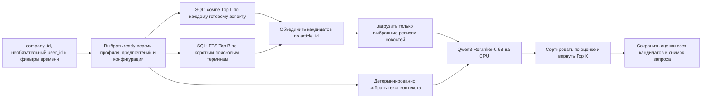

# Архитектура retrieval-ranking

## Границы ответственности

- Parser/Profiler подготавливают очищенные новости и неизменяемые ready-версии
  контекста компании и пользователя.
- Вызывающий embedding-service код сохраняет возвращённые векторы в общей БД.
  Сам embedding-service не хранит состояние.
- Retrieval-ranking читает готовые данные общей схемы и записывает только
  ranking_runs и ranking_items.
- Сервис не загружает новости из источников, не создаёт профили компаний,
  не запускает веб-поиск, не генерирует объяснения и не обучает поведенческую модель.

## Обработка запроса

Общие аспекты компании и совместимые персональные аспекты используют один
embedding_config_id. Деятельность, контрагенты, направления бизнеса группы,
финансирование и другие доступные аспекты задают независимые запросы
к одному индексу векторов новостей. Отдельный энкодер для каждого аспекта
не загружается. Для включения новости в пул достаточно попадания
хотя бы в один векторный канал или FTS.

Векторный поиск работает с текущей ревизией новости и выбранной
embedding-конфигурацией. Новости с duplicate_of_id исключаются,
временные фильтры применяются в SQL. Итеративный поиск HNSW в pgvector
уменьшает недобор после фильтрации. Если кандидатов всё ещё меньше лимита,
канал повторяется точным поиском по косинусному расстоянию в SQL.
Заполненная выдача ANN остаётся приближённой.
Тексты загружаются только для объединённого пула кандидатов.

FTS использует существующее русскоязычное GIN-выражение и безопасное
OR-объединение фразовых запросов из заданных названий, псевдонимов,
ключевых слов, интересов и списка наблюдения пользователя.
FTS может найти новость, для которой ещё нет эмбеддинга.
Это PostgreSQL FTS. BM25 в текущем сервисе не используется.
Cosine similarity и ts_rank_cd сохраняются раздельно и не суммируются.

## Ранжирование и трассировка

Одна транзакция только для чтения с уровнем repeatable read фиксирует
контекст и ревизии кандидатов. До запуска модели транзакция закрывается.
Каждая новость представляется одной строкой в памяти: заголовок,
дата публикации, источник, описание и основной текст.
Контекст содержит выбранные факты о компании, цели, описания аспектов
и явно заданные приоритеты пользователя, если они есть.
Эмбеддинги на вход ранкера не передаются.

Закреплённая версия Qwen оценивает каждую пару контекст–новость.
Используются публичные базовые веса без дообучения на задаче.
Оценка равна logit(yes) - logit(no) и не является вероятностью.
При сортировке сначала используется score по убыванию,
затем article_id по возрастанию для разрешения равенств.
Сервис возвращает min(K, N) новостей. Порог релевантности не задан.

В ranking_runs сохраняются ID профиля, пользовательского контекста
и embedding-конфигурации, время запроса, версии, текст контекста и его хеш,
лексические термины, revision модели, инструкция и токен-бюджеты.
ranking_items содержит всех N оценённых кандидатов, исходные попадания
поисковых каналов, точную content_version, score и диагностику усечения.
За пределами видимого Top K поле rank равно NULL.
Итоговая запись атомарна; только после неё запуск получает status=completed.
При ошибке модели или записи начатый запуск помечается как failed.

Единица результата — отдельная статья. Точные дубликаты должны быть
заранее связаны через duplicate_of_id. event_id сохраняется;
публикации об одном событии не объединяются сервисом автоматически.

## Ограничения

- Обязательны ready-профиль и ready-аспекты. Персональный запрос дополнительно
  требует активного членства пользователя в компании и ready user_preferences.
  Персональные векторные аспекты могут отсутствовать; текст предпочтений
  всё равно используется в FTS и ранжировании.
- Для пустого пула сохраняется завершённый запуск с пустой выдачей.
- Новости без даты по умолчанию исключены. Параметр include_undated
  явно меняет это поведение.
- as_of ограничивает доступные версии контекста и даты текущих новостей.
  Он не восстанавливает прежнее состояние корпуса после изменения
  текущей ревизии статьи.
- Контекст и новость сокращаются с сохранением начала каждого текста;
  фиксированный суффикс модели сохраняется. Признаки усечения возвращаются
  в ответе и записываются в БД. Для длинных контекстов нужна оценка качества.
- Используется один процесс API; одновременно выполняется один CPU-запрос
  ранжирования. Остальные запросы получают 429.
- Тесты с синтетическими векторами проверяют связность и инварианты.
  Recall@K и качество ранжирования оцениваются отдельно по размеченным данным.
  Выполненные измерения и их ограничения описаны в
  [VALIDATION](docs/VALIDATION.md).
